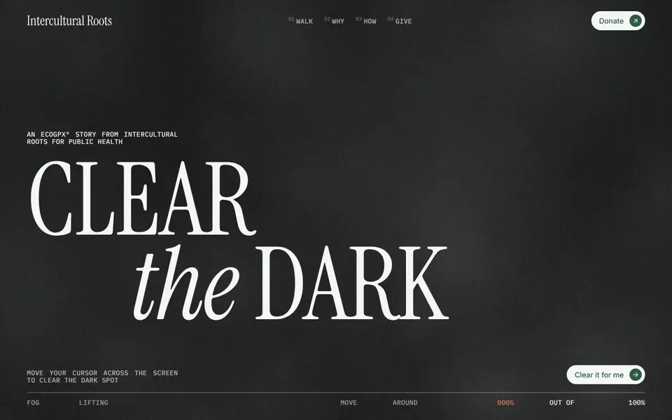
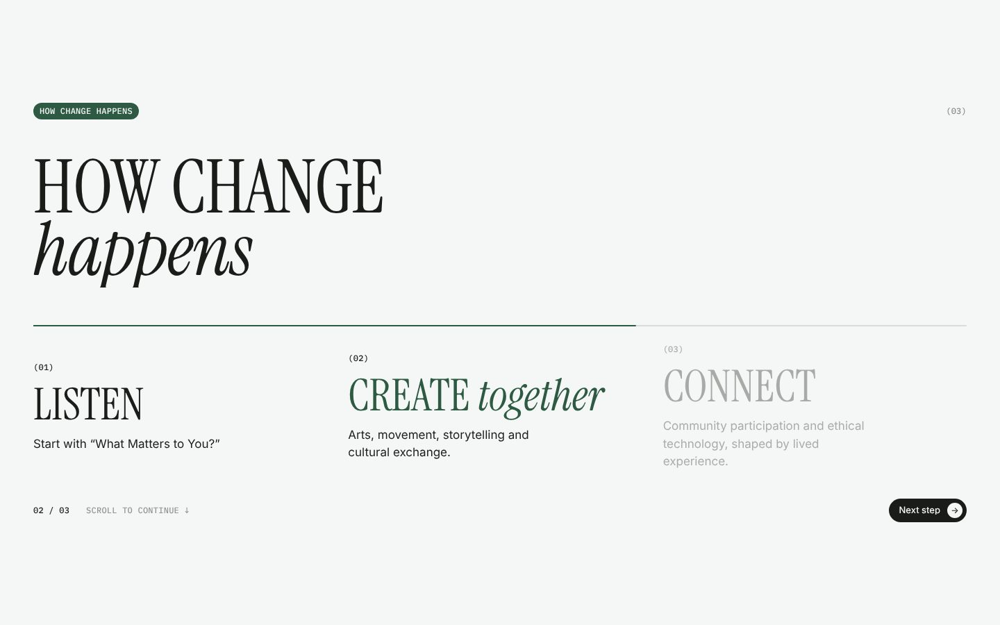
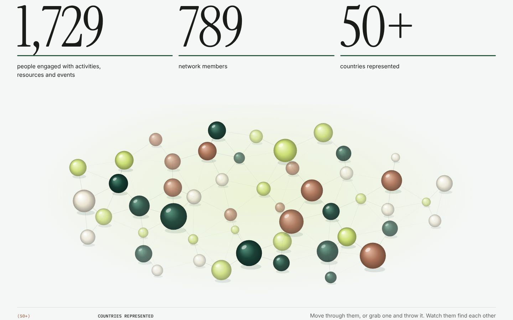
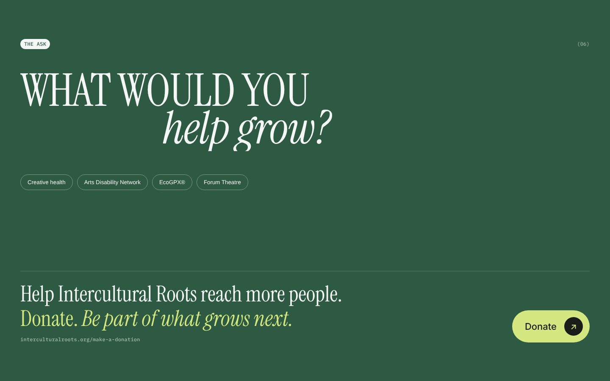

# Clear the Dark

**Track 2 winner, CapCut × EAST2046 hackathon, University of Cambridge Film and Interactive Web Lab (22 Oct 2026).**

An interactive donation story for [Intercultural Roots for Public Health](https://interculturalroots.org) (IRPH), a charity that uses creativity to tackle loneliness and disconnection. Built in 3–4 hours by Jack and ZJ, two second-year engineering students.

## Try it

Open [`dist/index.html`](dist/index.html) in a browser. It is one self-contained file.

## The brief

Track 2 asked for a single-file web page with at least two kinds of interaction, plus a reusable workflow document. The audience is people discovering IRPH for the first time, especially potential donors. The tone had to be human, hopeful and bold, and work with or without sound. Every claim had to be checkable against the IRPH Impact Report 2024–25, and the page ends by asking people to donate. Judges scored the page and the workflow equally.

## What's on the page

1. **Clear the dark.** A participant said the EcoGPX® programme got them out of "a dark spot". The page opens on that dark spot, and you clear it by moving your cursor (or tap *Clear it for me*).
2. **A walk out of the dark.** An optional 3D world, generated with [MANI Engine](https://maniengine.com) from a written prompt, that goes from a grey street to a community garden at golden hour. It has *Skip the walk* and *Walk for me*, and the page never depends on it.
3. **How change happens.** IRPH's Listen → Create together → Connect model, advancing as you scroll.
4. **Impact.** 1,729 people engaged, 789 network members and 50+ countries, shown as a cluster of spheres you can grab and throw.
5. **The ask.** *What would you help grow?*, the four programmes, and a link to the donation page.

| | | |
|---|---|---|
|  |  |  |

## The hand-off into 3D

The walk is a separate MANI world, but entering and leaving it feels like one page:

- **Preloaded:** the world's iframe is on the page from the start and stays hidden until it has loaded.
- **One continuous shot:** the image under the fog is the world's first frame. On entry, a full-screen copy of it covers the page, the page jumps to the world, and the cover fades to reveal the live 3D (waiting up to 10 s for slow connections).
- **Scroll to keep going:** enter automatically after the fog, with *Enter now*, or by scrolling, as the framed window grows to fill the screen.
- **Scrolling vs walking:** only once the world fills the screen does it take the mouse and keyboard, so WASD walks instead of scrolling.
- **A way back out:** the world's portal posts `irph:returned` to the page, which moves on to the next section.

Full details: [`MANI_LINK.md`](MANI_LINK.md).

## How it was made

- **Content in one place:** every word, quote, number and credit lives in one config object at the top of the script, so the charity can update it without touching the code.
- **Fact-checked:** each claim is listed with its source and page. No AI-generated people, photos, quotes or statistics.
- **Tested:** on a phone, keyboard only, with reduced motion, and with the 3D walk skipped.
- **AI use:** Claude (Claude Code) drafted HTML, CSS and JavaScript, which we reviewed and tested; MANI Engine generated the 3D world. Prompts and process: [`WORKFLOW.md`](WORKFLOW.md) and [`docs/workflow.pdf`](docs/workflow.pdf).

## Repo layout

| Path | What |
|---|---|
| `index.html` | The page source |
| `build.py` | Inlines the assets into one file: `python3 build.py` |
| `dist/index.html` | The built, self-contained page |
| `dist/mani-scene.html` | The MANI world's scene script |
| `assets/` | Images used by the page |
| `PLAN.md`, `WORKFLOW.md`, `MANI_LINK.md` | Plan, workflow document and embed notes |

## Credits

Content and photos: Intercultural Roots for Public Health (Registered Charity No. 1179885), from the IRPH Creator Lab brief and Impact Report 2024–25. Photo credits are listed in the page footer.
